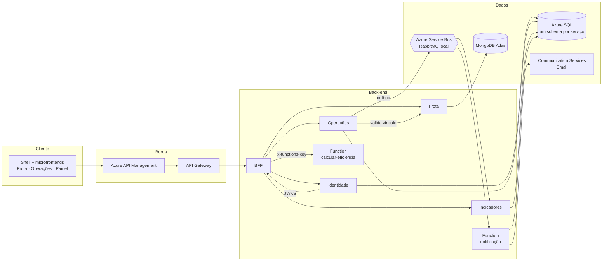

# NexFleet

Plataforma de gestão de frotas empresariais em nuvem: veículos, motoristas, vínculos, abastecimentos, manutenções, painel de custos e visão consolidada de eficiência em um só lugar.

[](https://github.com/mateusblm/nexfleet/actions/workflows/ci.yml)


[](https://hub.docker.com/u/mateusblm)

---

## Visão geral

O NexFleet centraliza a operação de uma frota: cadastro de veículos e motoristas, vínculos com histórico, registro de abastecimentos e manutenções com hodômetro protegido, painel de custos e uma visão consolidada que calcula consumo médio e custo por km de cada veículo e da frota inteira. Cada abastecimento dispara uma notificação por e-mail.

O produto é composto por microfrontends, um API Gateway, um BFF, quatro microsserviços com dados isolados e uma Azure Function, integrados por HTTP e por eventos. Este é o repositório **guarda-chuva**: documentação, decisões de arquitetura, contratos, infraestrutura como código (Bicep e Docker Compose), verificação de qualidade e scripts. O código de cada componente vive no próprio repositório.



## Repositórios

O NexFleet está organizado em nove repositórios públicos. Cada um tem README, build próprio e CI; os de serviço publicam a imagem `mateusblm/<repositório>` no Docker Hub a cada tag `v*`.

| Repositório | Responsabilidade | Tecnologia | Imagem Docker |
|---|---|---|---|
| [nexfleet](https://github.com/mateusblm/nexfleet) (este) | Documentação, ADRs, contratos OpenAPI/AsyncAPI, Compose, Bicep, bootstrap do SQL, verificação e scripts | Bicep, Docker Compose, Maven (`quality/`) | — |
| [nexfleet-frontend](https://github.com/mateusblm/nexfleet-frontend) | Shell e microfrontends Frota, Operações e Painel; página AsyncAPI | React 19, TypeScript, Vite | — (site estático) |
| [nexfleet-gateway](https://github.com/mateusblm/nexfleet-gateway) | API Gateway e Swagger UI única | Spring Cloud Gateway | [`mateusblm/nexfleet-gateway`](https://hub.docker.com/r/mateusblm/nexfleet-gateway) |
| [nexfleet-bff](https://github.com/mateusblm/nexfleet-bff) | BFF web, inclusive `GET /aggregated-data` | Spring Boot (Web MVC) | [`mateusblm/nexfleet-bff`](https://hub.docker.com/r/mateusblm/nexfleet-bff) |
| [nexfleet-identidade](https://github.com/mateusblm/nexfleet-identidade) | Login, JWT RSA/JWKS e usuários | Spring Boot, Azure SQL | [`mateusblm/nexfleet-identidade`](https://hub.docker.com/r/mateusblm/nexfleet-identidade) |
| [nexfleet-frota](https://github.com/mateusblm/nexfleet-frota) | Veículos, motoristas e vínculos | Spring Boot, MongoDB Atlas | [`mateusblm/nexfleet-frota`](https://hub.docker.com/r/mateusblm/nexfleet-frota) |
| [nexfleet-operacoes](https://github.com/mateusblm/nexfleet-operacoes) | Abastecimentos, manutenções, hodômetro e outbox | Spring Boot, Azure SQL, Service Bus/RabbitMQ | [`mateusblm/nexfleet-operacoes`](https://hub.docker.com/r/mateusblm/nexfleet-operacoes) |
| [nexfleet-indicadores](https://github.com/mateusblm/nexfleet-indicadores) | Projeções por evento e painel | Spring Boot, Azure SQL, Service Bus/RabbitMQ | [`mateusblm/nexfleet-indicadores`](https://hub.docker.com/r/mateusblm/nexfleet-indicadores) |
| [nexfleet-function](https://github.com/mateusblm/nexfleet-function) | Cálculo de eficiência e notificação de abastecimento | Azure Functions Java, Azure SQL | [`mateusblm/nexfleet-function`](https://hub.docker.com/r/mateusblm/nexfleet-function) (execução local) |

## Funcionalidades

| Área | O que o produto oferece |
|---|---|
| Acesso | Login com JWT assinado por RSA; perfis **Administrador** e **Gestor de Frota**; gestão de usuários |
| Frota | Veículos, motoristas e vínculos motorista ↔ veículo com histórico; um vínculo ativo por veículo; inativação e exclusão definitiva apenas sem histórico |
| Operações | Abastecimentos e manutenções; o hodômetro nunca regride; abastecimento só com vínculo válido |
| Painel | Gastos, situação da frota e próximas manutenções |
| Visão consolidada | Consumo médio (km/l), custo por km e gastos por veículo e da frota, com retorno parcial quando uma fonte falha |
| Notificações | E-mail automático a cada abastecimento, por função serverless |
| Documentação | Swagger UI única para todas as APIs e página AsyncAPI dos eventos |

**Estilos de arquitetura:** microfrontends, API Gateway + BFF, microsserviços com dados isolados por serviço, arquitetura orientada a eventos (outbox, consumidores idempotentes, retry e DLQ), serverless e Clean Architecture + Vertical Slice, com regras verificadas pelo ArchUnit em cada serviço.

## Visão consolidada: `GET /aggregated-data`

O BFF compõe três fontes em uma única resposta:

1. **Frota** (veículos, motoristas e vínculos ativos) e **Operações** (abastecimentos e manutenções) são consultadas em paralelo, cada uma com tempo limite próprio (padrão 5 s);
2. o histórico de Operações, agrupado por veículo, é enviado à **Function `calcular-eficiencia`**, que devolve consumo médio, custo por km e gastos;
3. a resposta traz `frota`, `operacoes`, `eficiencia`, `fontes` e `geradoEm`.

```json
{
  "frota": { "veiculos": [ … ], "motoristas": [ … ], "vinculosAtivos": [ … ] },
  "operacoes": { "abastecimentos": [ … ], "manutencoes": [ … ], "truncado": false },
  "eficiencia": {
    "veiculos": [ { "veiculoId": "…", "placa": "ABC1D23", "consumoMedioKmL": 6.25, "custoPorKm": 1.50, "gastoTotal": 750.00, "distanciaKm": 500, … } ],
    "frota": { "consumoMedioKmL": 6.25, "custoPorKm": 1.50, "gastoTotal": 750.00, "distanciaKm": 500 }
  },
  "fontes": { "frota": "ok", "operacoes": "ok", "funcao": "ok" },
  "geradoEm": "2026-11-11T12:00:00Z"
}
```

Se uma fonte falha, a resposta continua `200`: a seção dela vem vazia e `fontes.<fonte>` vem `"falhou"`. Sem Operações, a Function não é chamada. Só quando as três falham a resposta é `502`. Contrato completo em [contracts/aggregated-data.openapi.yaml](contracts/aggregated-data.openapi.yaml).

## Eventos

Operações grava cada registro e o evento correspondente na mesma transação (outbox) e um job os publica no broker.

| Evento | Canal | Consumidores |
|---|---|---|
| `AbastecimentoRegistrado` v1 | `operacoes.abastecimento.registrado.v1` | Indicadores (painel), Function (e-mail) |
| `ManutencaoRegistrada` v1 | `operacoes.manutencao.registrada.v1` | Indicadores (painel) |

Na nuvem, os eventos trafegam pelo tópico `nexfleet-eventos-v1` do Azure Service Bus (assinaturas `indicadores-v1` e `notificacoes-abastecimentos-v1`); localmente, pelo RabbitMQ, com retry e DLQ. Os consumidores são idempotentes. Contrato em [contracts/eventos.asyncapi.yaml](contracts/eventos.asyncapi.yaml) e na [página AsyncAPI](https://white-mushroom-0cadda010.3.azurestaticapps.net/docs/eventos/).

## Início rápido local

**Pré-requisitos:** Docker com Compose v2, `bash`, `curl`, `jq`, `openssl` e `git`; cerca de 6 GB de RAM livres (o SQL Server usa até 2 GB). Node.js 24 apenas para as telas.

```bash
git clone https://github.com/mateusblm/nexfleet.git && cd nexfleet
scripts/iniciar-local.sh      # 1ª vez: .env com senhas aleatórias + chave RSA da Identidade
docker compose up -d          # imagens mateusblm/nexfleet-* do Docker Hub, SQL Server, MongoDB, RabbitMQ
scripts/seed-demo.sh          # veículos, motoristas, vínculos, abastecimentos e manutenções
```

Para compilar a partir do código, clone os repositórios lado a lado e use o override de build:

```bash
scripts/clonar-tudo.sh        # clona os 8 repositórios nexfleet-* ao lado deste
docker compose -f compose.yaml -f compose.build.yaml up -d --build
```

Telas (no repositório `nexfleet-frontend`, um terminal por pasta, `npm ci` na primeira vez):

```bash
cd frontend && npm run dev                    # 5173 (shell)
cd microfrontends/frota && npm run dev        # 5174
cd microfrontends/operacoes && npm run dev    # 5175
cd microfrontends/painel && npm run dev       # 5176
```

| Endereço | Uso |
|---|---|
| http://127.0.0.1:5173 | Aplicação (login com `LOCAL_USER_EMAIL` / `LOCAL_USER_PASSWORD` do `.env`) |
| http://127.0.0.1:8080/swagger-ui.html | Swagger UI (BFF, Frota, Operações, Identidade, Indicadores) |
| http://127.0.0.1:8080/aggregated-data | Visão consolidada (com token) |
| http://127.0.0.1:15672 | Console do RabbitMQ (`RABBITMQ_USER` / `RABBITMQ_PASSWORD`) |

Para parar: `docker compose down` (os dados são preservados; `-v` apaga os volumes).

> **macOS:** `scripts/seed-demo.sh` usa `date -d`, disponível no `date` do GNU. Instale o `coreutils` (`brew install coreutils`) e coloque o `gnubin` dele no `PATH` antes de rodar o seed.

**Testes:** `./mvnw -B -ntp verify` em cada repositório de serviço; `npm ci && npm test && npm run build` em cada aplicação do `nexfleet-frontend`; aqui, `./mvnw -B -ntp -f quality/pom.xml verify` confere contratos, diagramas e tabelas contra o código dos repositórios irmãos clonados em `../` (ou na pasta indicada por `-Dnexfleet.repos.dir`).

## Ambiente em nuvem

| Recurso | Endereço |
|---|---|
| Aplicação | https://white-mushroom-0cadda010.3.azurestaticapps.net |
| API (Azure API Management) | https://apim-nexfleet-homolog-ukzjodf42myfe.azure-api.net |
| Swagger UI | https://apim-nexfleet-homolog-ukzjodf42myfe.azure-api.net/swagger-ui.html |
| Visão consolidada (com token) | https://apim-nexfleet-homolog-ukzjodf42myfe.azure-api.net/aggregated-data |
| AsyncAPI dos eventos | https://white-mushroom-0cadda010.3.azurestaticapps.net/docs/eventos/ |
| Imagens Docker | https://hub.docker.com/u/mateusblm |

O acesso à aplicação exige uma conta.

| Local (Docker Compose) | Azure |
|---|---|
| Shell e microfrontends no Vite | Static Web Apps |
| Spring Cloud Gateway | API Management (Consumption) + Container Apps |
| 6 serviços Java (imagens do Docker Hub) | 6 Container Apps com escala a zero |
| SQL Server 2022 (um schema por serviço) | Azure SQL Database serverless |
| MongoDB 7.0 | MongoDB Atlas |
| RabbitMQ | Service Bus Standard |
| Function local + captura de e-mail | Azure Functions (Flex Consumption) + Communication Services Email |

> Os serviços escalam a zero e o banco pausa sem uso. A primeira requisição após um período de inatividade pode levar de 1 a 2 minutos. `scripts/smoke-publico.sh` aquece e verifica o ambiente publicado.

Toda a infraestrutura está em Bicep (`infra/azure`); o passo a passo da publicação está no [guia de infraestrutura](docs/GUIA-INFRAESTRUTURA-AZURE-BICEP.md).

## Documentação

| Para... | Leia |
|---|---|
| Entender a arquitetura | [docs/ARQUITETURA.md](docs/ARQUITETURA.md) |
| Diagramas C4, UML e DER | [docs/DIAGRAMAS-ARQUITETURA.md](docs/DIAGRAMAS-ARQUITETURA.md) |
| Decisões de arquitetura (ADRs) | [docs/adr](docs/adr) |
| Contratos OpenAPI e AsyncAPI | [contracts/](contracts/) |
| Publicar na Azure | [docs/GUIA-INFRAESTRUTURA-AZURE-BICEP.md](docs/GUIA-INFRAESTRUTURA-AZURE-BICEP.md) |
| Executar localmente e resolver problemas | [docs/GUIA-EXECUCAO-LOCAL.md](docs/GUIA-EXECUCAO-LOCAL.md) |
| Usar e operar o sistema | [docs/GUIA-USO-E-OPERACAO.md](docs/GUIA-USO-E-OPERACAO.md) |
| Administrar contas e serviços na Azure | [docs/GUIA-ADMINISTRACAO-AZURE.md](docs/GUIA-ADMINISTRACAO-AZURE.md) |
| Histórico de versões | [CHANGELOG.md](CHANGELOG.md) |

Estrutura deste repositório:

```text
contracts/   contratos OpenAPI e AsyncAPI
docs/        guias, ADRs, diagramas e notas de versão
infra/       Bicep da Azure, bootstrap do SQL Server, RabbitMQ e Function local
quality/     verificação de contratos e diagramas contra o código, carga e homologação
scripts/     execução local, seed, smoke e publicação
```

## Custos e operação

Todos os Container Apps rodam com mínimo de zero réplicas e o Azure SQL serverless pausa automaticamente sem uso; o Service Bus Standard é o único custo fixo do ambiente.
Logs e métricas vão para Log Analytics e Application Insights; cada serviço expõe health checks e métricas Prometheus, e o `X-Correlation-ID` acompanha a requisição de ponta a ponta.

## Segurança

Senhas, chaves e identificadores da assinatura nunca são versionados:

- `.env`, `.secrets/` e os perfis e parâmetros da Azure ficam fora do repositório; cada ambiente local gera os seus com `scripts/iniciar-local.sh`;
- na Azure, segredos ficam em secrets dos Container Apps e nas configurações da Function; Service Bus e e-mail usam identidade gerenciada;
- Azure SQL e MongoDB Atlas exigem TLS; cada serviço tem usuário de banco próprio e só enxerga o próprio schema.

## Equipe

- Vinícius dos Reis Góes
- Mateus Burlamaqui
- Lucas Roussenq
- Erik Carvalho
