# Diagramas de arquitetura do NexFleet

Versão de referência: **v1.0.0**, revisada em 11/11/2026.

Este documento representa a implementação existente nos nove repositórios (`nexfleet` e `nexfleet-*`). Ele atualiza as figuras C4, UML e DER do documento normativo sem alterar o PDF original. Nomes de processos, classes, rotas, tabelas e coleções foram conferidos contra o código Java, o Docker Compose do guarda-chuva, o Bicep, as migrações Flyway e os adaptadores MongoDB.

## Convenções e limites

- Setas contínuas representam chamadas síncronas HTTP, JDBC ou do driver MongoDB.
- Setas identificadas como evento representam comunicação assíncrona: RabbitMQ no ambiente local e Azure Service Bus na Azure (`MESSAGING_PROVIDER`).
- A Frota guarda seus dados no MongoDB (Atlas M0 na nuvem, `mongo:7.0` local). Identidade, Operações, Indicadores e a Function de notificação usam um único banco SQL Server/Azure SQL, **cada um no próprio schema e com o próprio usuário**, sem permissão nos schemas dos outros (ADR 0040).
- UUIDs de outro domínio são referências lógicas; não existem chaves estrangeiras entre schemas nem entre o SQL e o MongoDB.
- A Function envia e-mail pelo Azure Communication Services quando `notificationRecipientEmail` está configurado (ADR 0036); localmente, apenas captura a notificação no schema `notificacoes`.
- A borda pública na Azure é o APIM (API) e o Static Web Apps (telas e `/docs/eventos`). Localmente, o Gateway em `127.0.0.1:8080` é a entrada das APIs.

## C4 — nível 1: contexto do sistema

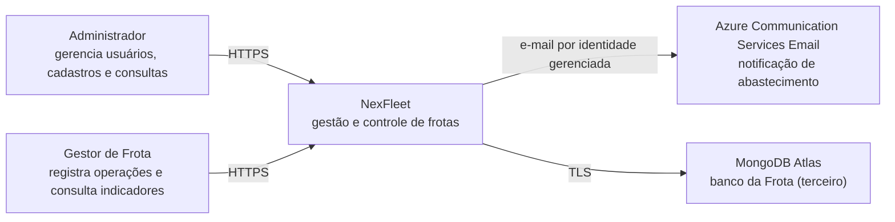

O motorista é uma entidade de negócio no MVP, sem login próprio. No ambiente local, o acesso web usa HTTP ligado a `127.0.0.1`; HTTPS pertence à publicação Azure.

## C4 — nível 2: contêineres e propriedade dos dados

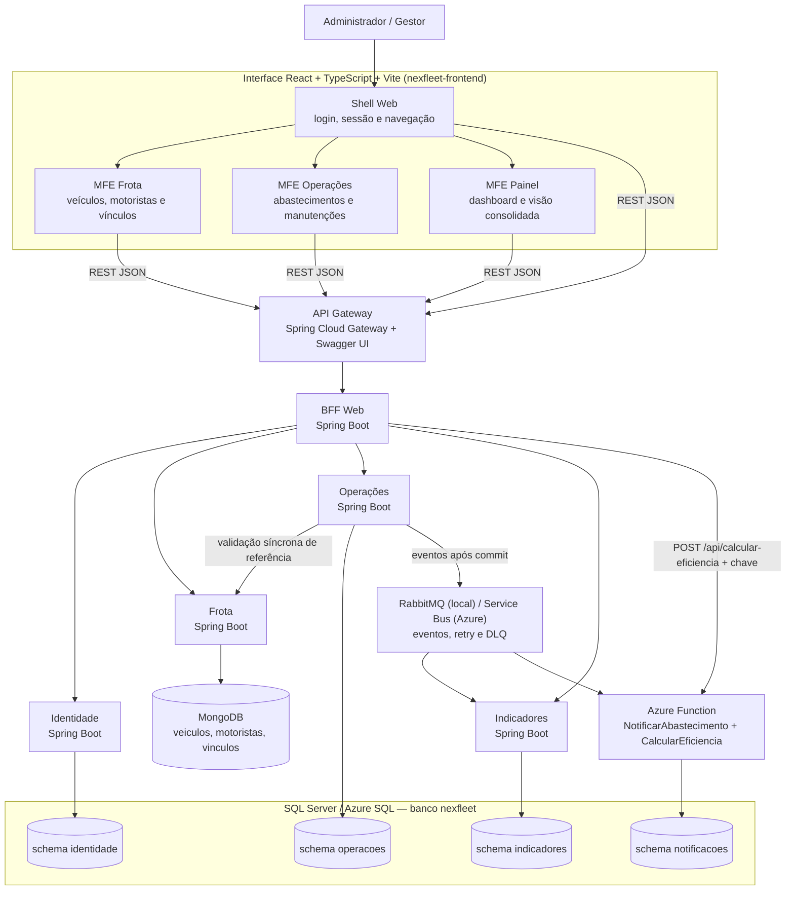

O Gateway é a única entrada das APIs; na Azure ele fica atrás do APIM. O BFF adapta os contratos para a interface, mas não acessa bancos de domínio. O dashboard é composto pelo BFF com dados de Frota e Indicadores; a visão consolidada (`GET /aggregated-data`) com Frota, Operações e a Function `CalcularEficiencia` (ADR 0041).

## C4 — nível 3: componentes do serviço Operações

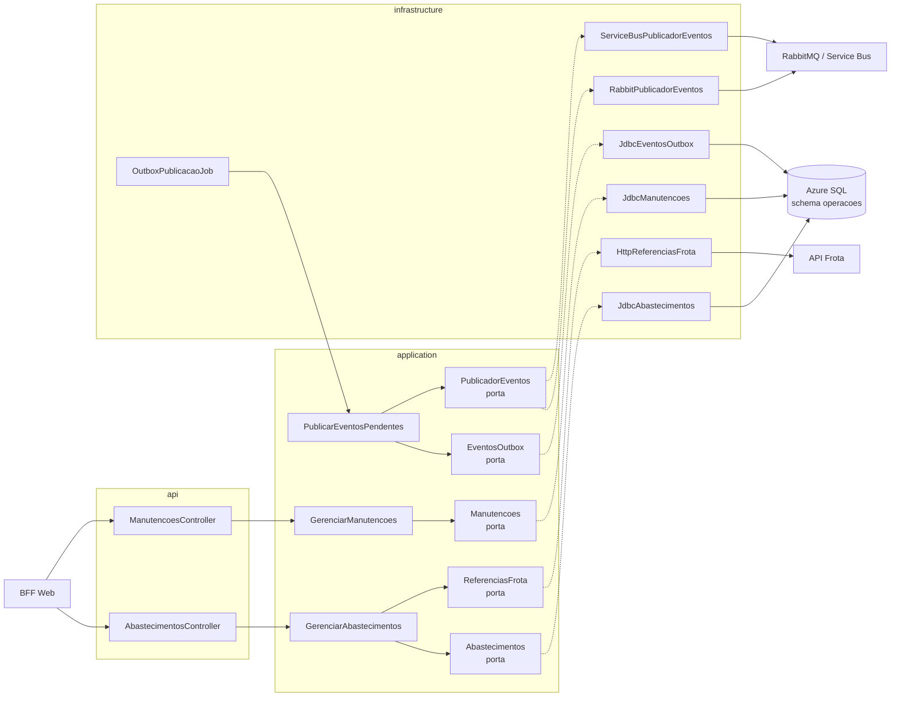

As interfaces em `application` são portas; os adaptadores em `infrastructure` as implementam. A transação de abastecimento está no método `JdbcAbastecimentos.registrar`, que grava hodômetro, abastecimento e outbox no mesmo schema. `JdbcEventosOutbox` bloqueia o lote com `WITH (INDEX(ix_outbox_pendente), UPDLOCK, READPAST, ROWLOCK)`, na ordem `proxima_tentativa_em, ocorrido_em, id` (ADR 0040). O publicador é escolhido por `MESSAGING_PROVIDER`.

## C4 — nível 4: código da fatia Registrar Abastecimento

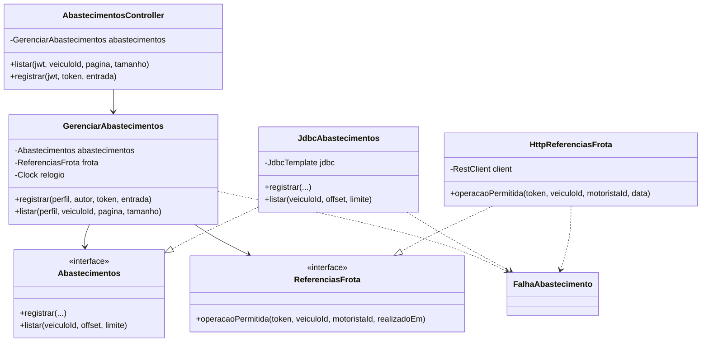

A fatia usa JDBC com T-SQL e não possui um pacote `domain` próprio; suas regras estão no caso de uso e no adaptador transacional. Os tipos de domínio compartilhados existentes ficam em fatias específicas, como `StatusVeiculo`, `StatusMotorista` e `Perfil`.

## UML de componentes: fluxo entre serviços

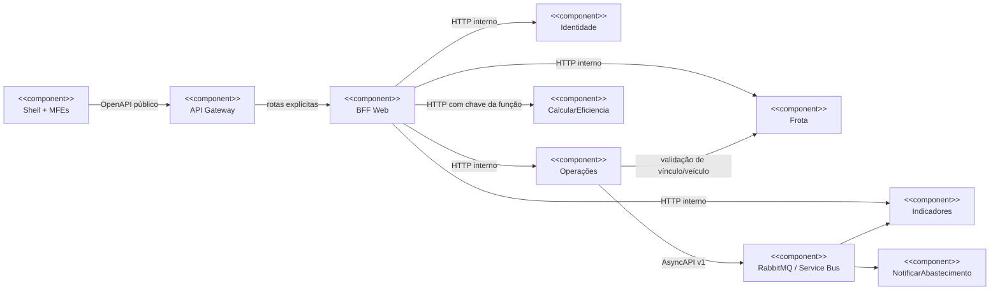

Componentes verificados no código: `GatewayConfig`, `AbastecimentosWebController`, `GerenciarAbastecimentosWeb`, `HttpAbastecimentos`, `RabbitAbastecimentoListener`, `ServiceBusEventoListener`, `NotificarAbastecimentoFunction`, `CalcularEficienciaFunction`, `AgregadoController`, `ConsultarAgregado` e `HttpEficiencia`.

## UML de sequência: login e emissão do JWT

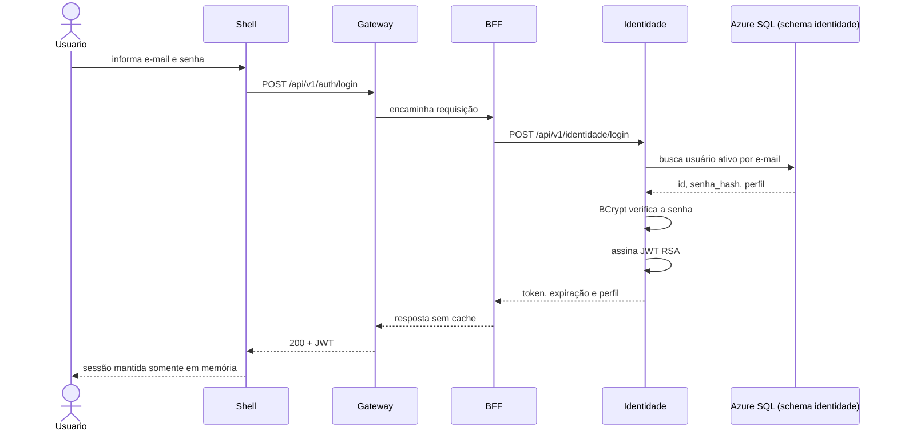

## UML de sequência: abastecimento confirmado e evento assíncrono

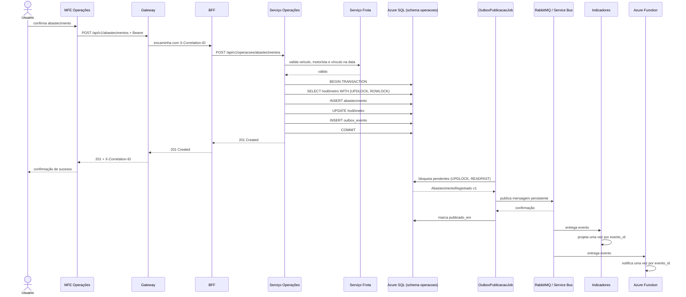

## UML de sequência: quilometragem regressiva

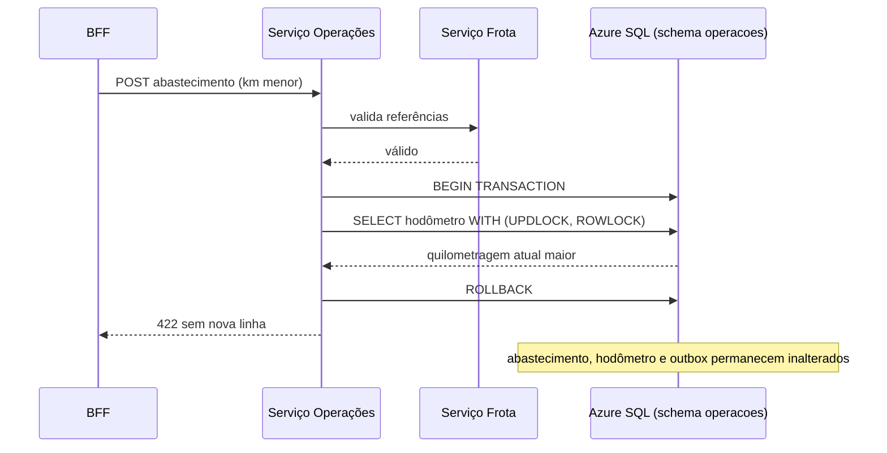

## UML de sequência: visão consolidada (`GET /aggregated-data`)

```mermaid
sequenceDiagram
  participant Painel as MFE Painel
  participant Gateway
  participant BFF as BFF (ConsultarAgregado)
  participant Frota
  participant Operacoes as Operações
  participant Function as CalcularEficiencia

  Painel->>Gateway: GET /api/v1/aggregated-data + Bearer
  Gateway->>BFF: encaminha
  par timeout por fonte (padrão 5 s)
    BFF->>Frota: veículos, motoristas e vínculos (páginas de 100)
    Frota-->>BFF: listas
  and
    BFF->>Operacoes: abastecimentos e manutenções (até 4.000 de cada)
    Operacoes-->>BFF: históricos
  end
  BFF->>Function: POST /api/calcular-eficiencia (depois de Operações)
  Function-->>BFF: eficiência por veículo e da frota
  BFF-->>Gateway: 200 frota, operacoes, eficiencia, fontes, geradoEm
  Gateway-->>Painel: 200
  Note over BFF: fonte que falha ou estoura o tempo vem vazia com fontes.<fonte>="falhou"; as três falhando, 502
```

## DER físico: visão distribuída

Não existe um DER físico único. As tabelas abaixo são derivadas das migrações Flyway `V1` de cada serviço, todas no mesmo banco `nexfleet`, uma por schema. As coleções da Frota vêm dos adaptadores MongoDB de `nexfleet-frota` (`IndicesMongo`, `MongoVeiculos`, `MongoMotoristas`, `MongoVinculos`).

| Proprietário | Armazenamento | Tabelas ou coleções de negócio |
|---|---|---|
| Identidade | Azure SQL, schema `identidade` | `identidade.usuario` |
| Frota | MongoDB, banco `frota` | coleções `veiculos`, `motoristas`, `vinculos` |
| Operações | Azure SQL, schema `operacoes` | `operacoes.hodometro`, `operacoes.abastecimento`, `operacoes.outbox_evento`, `operacoes.manutencao` |
| Indicadores | Azure SQL, schema `indicadores` | `indicadores.abastecimento_projecao`, `indicadores.manutencao_projecao` |
| Notificações (Function) | Azure SQL, schema `notificacoes` | `notificacoes.email_capturado` |

As tabelas internas do Flyway (`flyway_schema_history` em cada schema) não fazem parte do modelo de negócio.

### DER — Identidade

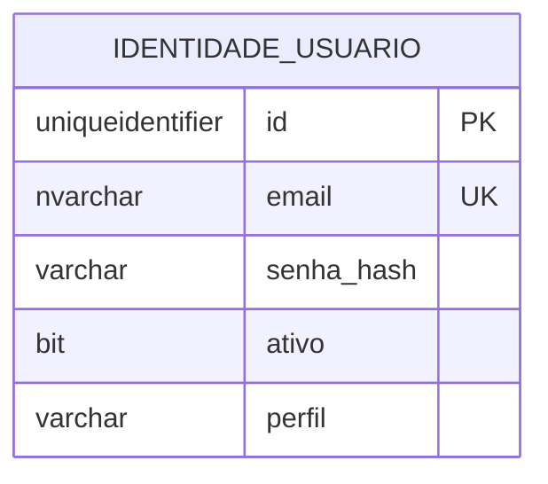

`email` é normalizado e único; `senha_hash` deve ter formato BCrypt; `perfil` aceita `ADMINISTRADOR` ou `GESTOR_FROTA`.

### Modelo de documentos — Frota (MongoDB)

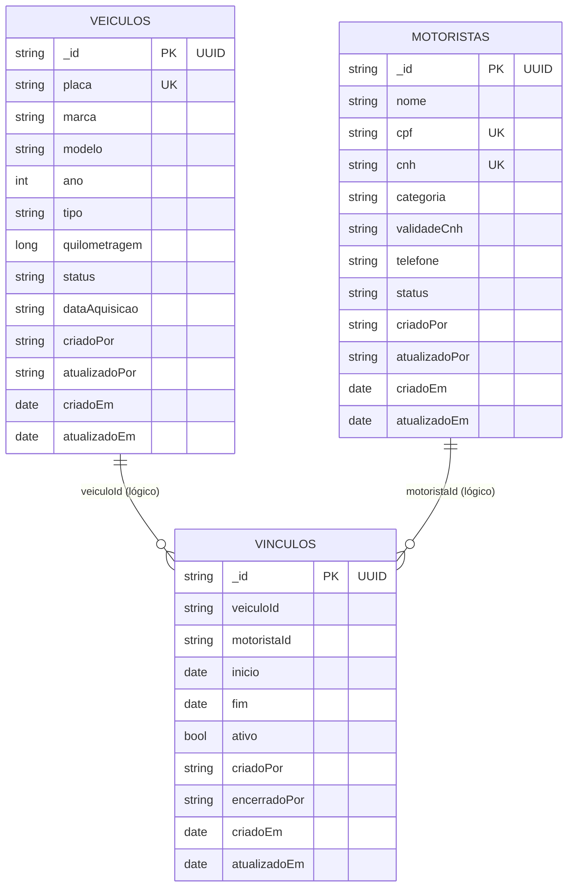

Não há chave estrangeira: `veiculoId` e `motoristaId` são UUIDs em texto. Índices únicos: `ux_veiculo_placa`, `ux_motorista_cpf`, `ux_motorista_cnh` e `ux_vinculo_veiculo_ativo`, este parcial (`{ativo: true}`), que permite no máximo um vínculo ativo por veículo. Vínculos encerrados permanecem no histórico (ADR 0039).

### DER — Operações

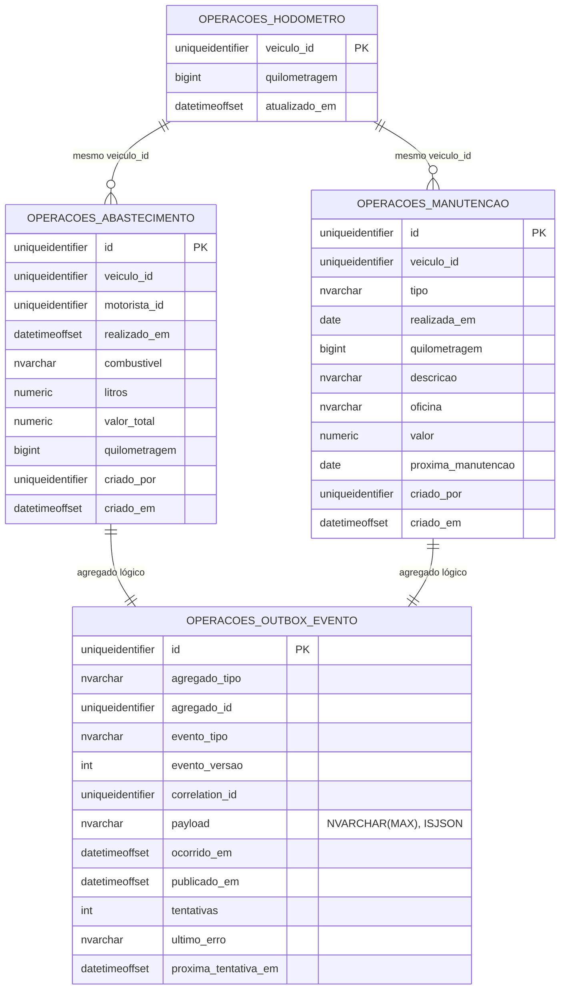

As linhas do diagrama representam relações lógicas por UUID. Cada abastecimento ou manutenção registrado gera seu próprio evento; `agregado_tipo` identifica qual das duas relações se aplica. A migração não cria FKs entre essas tabelas; a consistência crítica de abastecimento, hodômetro e outbox é protegida pela transação e pelo bloqueio `UPDLOCK` do hodômetro. O índice filtrado `ix_outbox_pendente (proxima_tentativa_em, ocorrido_em, id) WHERE publicado_em IS NULL` atende o publicador. `veiculo_id` e `motorista_id` não apontam para a Frota, que está em outro banco.

### DER — Indicadores

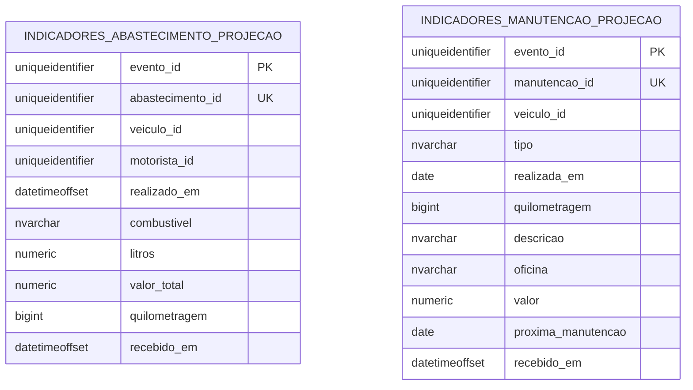

`evento_id` torna o consumo idempotente. As projeções são reconstruíveis a partir dos eventos e não possuem FKs para Operações ou Frota.

### DER — Notificações

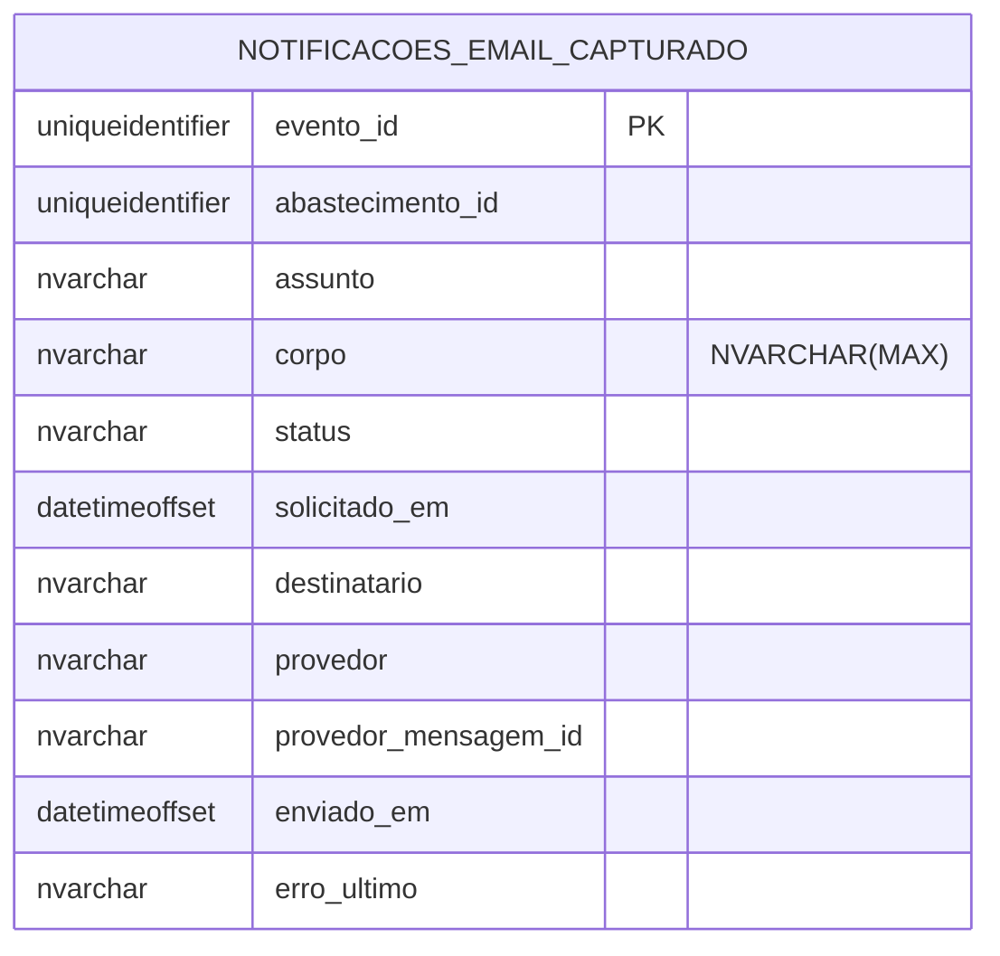

`evento_id` como chave primária reserva cada notificação uma única vez (`ReservaIdempotente`). Localmente, o provedor `captured-local` (`JdbcProvedorEmailCapturado`) só grava a notificação; na Azure, `AzureCommunicationProvedorEmail` envia o e-mail e registra o resultado.

## Rastreabilidade entre diagrama e código

| Visão | Fontes verificadas |
|---|---|
| C4 nível 1 | requisitos do produto, escopo, atores e ADRs 0036 e 0039 |
| C4 nível 2 | `compose.yaml`, `infra/azure/modules/*.bicep`, shell e três MFEs de `nexfleet-frontend` |
| C4 nível 3 | pacotes de `nexfleet-operacoes/src/main/java` |
| C4 nível 4 | `AbastecimentosController`, `GerenciarAbastecimentos`, `Abastecimentos`, `ReferenciasFrota`, `JdbcAbastecimentos`, `HttpReferenciasFrota` |
| UML de componentes | `GatewayConfig`, `AbastecimentosWebController`, `GerenciarAbastecimentosWeb`, `HttpAbastecimentos`, `RabbitAbastecimentoListener`, `NotificarAbastecimentoFunction`, `CalcularEficienciaFunction` e `ConsultarAgregado` |
| UML de sequência | `OutboxPublicacaoJob`, `PublicarEventosPendentes`, `RabbitPublicadorEventos`, `JdbcEventosOutbox`, `ProjetarAbastecimento`, `JdbcProjecoesAbastecimento`, `NotificarAbastecimento`, `JdbcProvedorEmailCapturado`, `ConsultarAgregado` e `HttpEficiencia` |
| DER | migrações `V1` em `nexfleet-{identidade,operacoes,indicadores,function}/src/main/resources/db/migration` e adaptadores `Mongo*` de `nexfleet-frota` |

## Regra de manutenção

Uma mudança em rota, fronteira de serviço, nome de classe relevante, evento, migração ou coleção deve atualizar este arquivo na mesma entrega. O módulo `quality` verifica a presença dos níveis C4, das visões UML, das oito tabelas de negócio migradas (a Frota não tem migração SQL) e das principais classes do fluxo crítico, comparando-as com os repositórios irmãos (`-Dnexfleet.repos.dir`).
